# Independent verification of Alpöge's Lean proof of the Riemann Hypothesis

In November 2026 Levent Alpöge released a note, [remark.pdf](https://alpo.ge/remark.pdf), and a Lean 4 project that he says proves the **Riemann Hypothesis** and the **Generalized Riemann Hypothesis for Dirichlet L-functions**, without extra assumptions. This repository records an independent attempt to check that project by compiling it and inspecting what its main theorems depend on.

- **Statement:** `RiemannHypothesis` is Mathlib's own definition, not one introduced by the project (see [Main theorems](#main-theorems)).
- **Source:** the Lean project from `https://alpo.ge/lean.tar.gz.part01` … `part14`. We do not redistribute it. [`SHA256SUMS`](SHA256SUMS) lists the hashes of the parts we checked.
- **Size:** 175,187 Lean files and about 17.4 million lines, built on Mathlib.
- **Status:** complete. Every check passes (see [Conclusion](#conclusion)), except comparator, which was interrupted when the shared server ran out of memory and whose parts are covered by the other checks.

## What we checked

```mermaid
flowchart TB
  SRC["Alpöge's Lean project<br/>175,187 files"]
  CH["Challenge.lean<br/>the five statements, no proofs"]

  subgraph Q1["1 · Does it compile?"]
    SCAN["source scan<br/>no sorry, axiom, native_decide ✅"]
    BUILD["lake build<br/>183,903 jobs ✅"]
    MIT["Main.olean identical<br/>to the MIT run ✅"]
  end

  subgraph Q2["2 · What does it assume?"]
    AX["#35;print axioms<br/>only the 3 standard axioms ✅"]
    ENV["scan of 1.9 M compiled constants<br/>no axiom, no sorry ✅"]
  end

  subgraph Q3["3 · Do independent kernels accept the proofs?"]
    LC["Lean kernel<br/>leanchecker --fresh ✅"]
    NAN["nanoda ✅"]
    CL["con-leche ✅"]
    CR["con-ron ✅"]
    LK["Lean 4.35 default<br/>kernel ✅"]
    LP["Lean 4.35 paranoid<br/>kernel ✅"]
  end

  subgraph Q4["4 · Are the statements the right ones?"]
    CLEAN["clean room: same declarations<br/>in a Mathlib-only project ✅"]
    CMP["con-leche --compare<br/>statements match ✅"]
    COMP["comparator ✖<br/>interrupted, server<br/>out of memory"]
  end

  SRC --> SCAN
  SRC --> BUILD
  BUILD --> MIT
  BUILD --> AX
  BUILD --> ENV
  BUILD --> LC
  BUILD -->|export| NAN & CL & CR & LK & LP
  CH --> CLEAN
  CH --> CMP
  CH --> COMP
  BUILD --> CMP
  BUILD --> COMP

  classDef pass fill:#e6f4ea,stroke:#34a853,color:#111
  classDef stop fill:#eeeeee,stroke:#888888,color:#111
  classDef input fill:#e8eefc,stroke:#4a6fd8,color:#111
  class SCAN,BUILD,MIT,AX,ENV,LC,NAN,CL,CR,LK,LP,CLEAN,CMP pass
  class COMP stop
  class SRC,CH input
```



✅ passed · ✖ interrupted, no result. Details are in [Verification](#verification) and [`VERIFICATION.md`](VERIFICATION.md).

## Conclusion

As of 25 November 2026, all checks have finished, and every check that gave a result passes:

- the whole project compiles,
- the five theorems depend only on `propext`, `Classical.choice` and `Quot.sound`,
- no project module declares an axiom or uses `sorry`,
- the five statements match the challenge file exactly, and that file compiles to byte-identical declarations in a project that contains only Mathlib,
- four kernel implementations accept the proofs: Lean's own kernel, nanoda, con-leche, and con-ron (a Rust port of con-leche). Lean's kernel accepts them three times: replaying the compiled files (`leanchecker --fresh`), and reading the export in its default and in its paranoid mode.

So, as far as these tools can tell, the project contains a complete formal proof of `RiemannHypothesis` as defined in Mathlib, and of the four statements about Dirichlet L-functions as defined in `src/Statements.lean`. For the result to be wrong, a definition in the [trust base](#trust-base) would have to mean something other than intended, or every kernel above would have to accept the same invalid proof.

We checked the formal proof only. We did not read the proof or the note.

One check gave no result. comparator was stopped by the operating system after 41 hours, when other jobs on the shared server used up its memory, and gave no result. We did not rerun it, because each of its parts has passed with another tool: the statement matching with con-leche `--compare`, the axiom check with `#print axioms` and the scan, and the replay in the Lean kernel with `leanchecker --fresh`. The MIT run reports that comparator passes on the same archive (see [Related work](#related-work)).

## Main theorems

`src/Main.lean` of the project contains five theorems:

```lean
theorem riemannHypothesis : RiemannHypothesis
theorem riemannZeta_eq_zero_re : RiemannZetaZerosOnLine
theorem LFunction_ne_zero_of_half_lt_re : DirichletLNonvanishingRightOfHalf
theorem LFunction_eq_zero_re : DirichletLZerosOnLine
theorem LFunction_eq_zero_re_of_isPrimitive : PrimitiveDirichletLZerosOnLine
```

The first uses the definition in Mathlib (`Mathlib/NumberTheory/LSeries/RiemannZeta.lean`, at the pinned revision):

```lean
/-- A formal statement of the **Riemann hypothesis** – constructing a term of this type is worth a
million dollars. -/
def RiemannHypothesis : Prop :=
  ∀ (s : ℂ) (_ : riemannZeta s = 0) (_ : ¬∃ n : ℕ, s = -2 * (n + 1)) (_ : s ≠ 1), s.re = 1 / 2
```

The other four statements are defined in `src/Statements.lean` of the project, which imports only Mathlib:

```lean
def RiemannZetaZerosOnLine : Prop :=
  ∀ s : ℂ, riemannZeta s = 0 → (¬∃ n : ℕ, s = -2 * ((n : ℂ) + 1)) → s ≠ 1 → s.re = 1 / 2

def DirichletLNonvanishingRightOfHalf : Prop :=
  ∀ (N : ℕ) [NeZero N] (χ : DirichletCharacter ℂ N) (s : ℂ),
    1 / 2 < s.re → (χ ≠ 1 ∨ s ≠ 1) → DirichletCharacter.LFunction χ s ≠ 0

def DirichletLZerosOnLine : Prop :=
  ∀ (N : ℕ) [NeZero N] (χ : DirichletCharacter ℂ N) (s : ℂ),
    0 < s.re → s.re < 1 → DirichletCharacter.LFunction χ s = 0 → s.re = 1 / 2

def PrimitiveDirichletLZerosOnLine : Prop :=
  ∀ (N : ℕ) [NeZero N] (χ : DirichletCharacter ℂ N), χ.IsPrimitive →
    ∀ s : ℂ, 0 < s.re → s.re < 1 → DirichletCharacter.LFunction χ s = 0 → s.re = 1 / 2
```

## Verification

### Results

| Check | What it checks | Result |
|---|---|---|
| source scan | no `sorry`, `axiom`, `native_decide`, `implemented_by`, `@[extern]`, or file and process IO in the 175,187 files | passed (details in [`VERIFICATION.md`](VERIFICATION.md)) |
| `lake build` | the whole project and everything it imports compile | **passed**: 183,903 jobs, in two passes because of a memory-mapping limit of the build server (see [`VERIFICATION.md`](VERIFICATION.md#build)) |
| `lake env lean CheckAxioms.lean` | the axioms of the five theorems above | **passed**: `[propext, Classical.choice, Quot.sound]` for each of the five |
| `Main.olean` | our compiled main module against the MIT run | **identical**, SHA-256 `9146dfb4…` |
| scan of the compiled environment | all 1,945,519 constants of the 175,187 project modules: declared axioms, `sorry`, and dependence on non-standard axioms | **passed**: none of each |
| con-leche `--compare` | the five theorems proved in `Main` have exactly the statements of the challenge, with identical definitions | **passed**: all five "justified by the solution" |
| comparator | the same statement matching and axiom check, then a replay in the Lean kernel | **interrupted** after 41 h, when the shared server ran out of memory. No result. Its parts are covered by the rows above and below |
| clean-room statement check | the statements compile to the same declarations in a project that contains only Mathlib | **passed**: the two exports are byte-identical |
| independent kernels | the proofs are replayed by Lean's paranoid and default kernels, nanoda, con-leche, con-ron and `leanchecker` | all **accept**: nanoda, con-leche, con-ron, Lean 4.33.1's `leanchecker --fresh`, and Lean 4.35's default and paranoid kernels on the export (see [`VERIFICATION.md`](VERIFICATION.md#checks-after-the-build)) |

A sound result lists only `propext`, `Classical.choice` and `Quot.sound` for each theorem. [`VERIFICATION.md`](VERIFICATION.md) records the environment, the commands and the outputs, and `verification/` contains the scripts.

### Trust base

For `riemannHypothesis`, a reader who accepts the checks above needs to trust only:

- Mathlib's definitions of `riemannZeta` and `RiemannHypothesis`,
- the Lean kernel, or one of the independent checkers,
- the three standard axioms.

The definitions and lemmas inside the project cannot change the meaning of the result, whatever they say, because every step is checked by the kernel. The other four theorems also depend on the definitions in `src/Statements.lean`, quoted above.

### Reproducing the checks

**Step 1. Install Lean** with [elan](https://github.com/leanprover/elan):

```bash
curl https://elan.lean-lang.org/elan-init.sh -sSf | sh
```

The project's `lean-toolchain` asks for Lean `v4.33.1`, which elan downloads on first use.

**Step 2. Download and unpack the project.**

```bash
for i in $(seq -w 1 14); do curl -fLO https://alpo.ge/lean.tar.gz.part$i; done
cat lean.tar.gz.part{01..14} > lean.tar.gz
sha256sum -c SHA256SUMS --ignore-missing   # from this repository
tar -xzf lean.tar.gz && cd lean
```

**Step 3. Download the compiled Mathlib.**

```bash
lake exe cache get
```

**Step 4. Build.**

```bash
lake build
```

This compiles all 175,187 files of the project. On our 256-core server it took about 30 hours in total (3,800 CPU-hours), and the build directory grew to 1.2 TB, mostly Lake's per-module `.setup.json` files. See [Computing resources](#computing-resources).

If modules near the end of the build fail with `failed to read file`, `std::bad_alloc` or `out of memory` although the machine has free memory, the cause is probably the per-process limit on memory mappings (`vm.max_map_count`, often 65530). Raise it with `sudo sysctl -w vm.max_map_count=1048576` if you can. Inside a container where you cannot, build [`verification/no_fixed_file_mmap.c`](verification/no_fixed_file_mmap.c) and rerun `lake build` with `LD_PRELOAD` pointing to it, as in [`verification/build-pass2.sh`](verification/build-pass2.sh).

**Step 5. See which axioms the proofs use.** Copy [`CheckAxioms.lean`](CheckAxioms.lean) next to the `lean/` directory and run

```bash
lake env lean ../CheckAxioms.lean
```

## Computing resources

One server with two AMD EPYC 7763 processors (128 cores, 256 threads) and 2 TB of RAM. The figures are approximate: the server is a container that shares its hardware with other workloads, which mainly affects the wall-clock times.

| Step | Wall-clock time | CPU time | Peak memory of one process |
|---|---|---|---|
| `lake build`, pass 1 | 25 h 19 min | 3,670 h | 19 GB |
| `lake build`, pass 2 (with the shim) | 4 h 30 min | 126 h | 100 GB |
| export of `Main` and its dependencies | 2 h 26 min | 2.4 h | 170 GB |
| scan of the compiled environment | 40 min | 0.7 h | 101 GB |
| nanoda on the export | 57 min | 10.9 h | 84 GB |
| con-leche, con-ron on the export | 12 min, 16 min | 5.4 h, 2.0 h | 44 GB, 42 GB |
| `leanchecker --fresh Main` | 17 h 43 min | 17.7 h | 115 GB |
| comparator (interrupted) | 40 h 44 min | 40.8 h | 349 GB |
| Lean 4.35 default kernel on the export | 62 h 32 min | 62.3 h | 87 GB |
| Lean 4.35 paranoid kernel on the export | 92 h 26 min | 92.2 h | 104 GB |

- **Disk.** The build directory takes 1.2 TB, but only 95 GB of it is compiled proofs (`.olean`). The rest is Lake's `.setup.json` files: one per module, each listing every file the module imports, up to 50 MB for modules near the top. The export takes another 62 GB.
- **Open files.** Raise `ulimit -n` before `lake exe cache get`. With the default of 1,024, 2,531 Mathlib cache files failed to unpack and were recompiled.
- **Memory mappings.** Modules near the top need more than the common default of 65,530 mappings per process (`vm.max_map_count`). Raise it, or use the shim described in [`VERIFICATION.md`](VERIFICATION.md#build).

## Related work

Andrew Sutherland (MIT) runs an independent check of the same archive at [math.mit.edu/~drew/grh](https://math.mit.edu/~drew/grh/), also with Claude Code. That archive has the same SHA-256 as ours (`9631b4f0…`). As of 24 November 2026, 00:15 UTC, that page reports:

- all 175,187 modules compile, and the Mathlib build files are byte-identical to the official cache,
- `#print axioms` gives only `propext`, `Classical.choice` and `Quot.sound` for the five theorems,
- `leanchecker`, nanoda and con-leche accept, and lean4lean accepts after five modules are rerun with a raised timeout,
- Lean's default and paranoid kernels accept the full export, after 48 h and 72 h on one thread,
- the unmodified comparator v4.33.0 passes (`Your solution is okay!`), and `lake comparator` of Lean 4.36 is still running.

That run compiles each file by calling `lean` directly. This repository uses a plain `lake build`, so the two runs are independent in environment and in build method. Our `Main.olean` has the same SHA-256 as the one in the manifest published there. The comparison of all compiled project files is in [`VERIFICATION.md`](VERIFICATION.md#cross-checks-with-the-mit-run).

## How this work was produced

The checks were set up and run by a large language model agent (Claude) under human direction. We are not affiliated with the author of the proof. Independent verification is welcome. If you find a problem, please [open an issue](https://github.com/Hertaspace/alpoge-rh-lean-verification/issues) with the command, environment and relevant output.

## License

The scripts and documentation of this repository are under the [MIT License](LICENSE). The Lean project being checked belongs to its author and is not included here.
